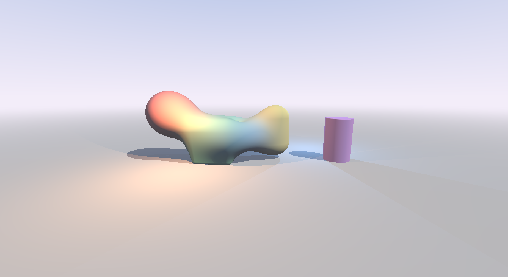

# sdf-odin

A real-time signed distance field renderer written in [Odin](https://odin-lang.org), on top of the SDL3 GPU API and [Slang](https://shader-slang.org) shaders.



Every shape in the scene is a distance function, ray marched per pixel in a single fullscreen pass. Shapes that come close melt into each other with a smooth union, and their colors blend along with them.

## Features

- **Primitives:** sphere, box, torus, capsule and cylinder.
- **Smooth blending:** a cubic smooth-min joins nearby shapes into one surface.
- **Lighting:** one directional light plus colored point lights, with shadows cast by marching a ray toward each light.
- **Fast marching:** each shape has a bounding sphere, so far shapes are skipped. Rays are clipped to a box around the whole scene, and the ground plane is hit analytically.
- **Shader hot reload:** edit `shaders/sdf.slang` while the app runs and the pipeline is recompiled.
- **ECS:** the scene is made of things with parts (`Transform`, `Shape`, `Light`, `Camera`, `Animation`), updated by systems that run in stages. See [`libs/ecs`](libs/ecs/README.md).

## Running

The dev shell provides Odin, Slang, SDL3 and `just`:

```sh
nix develop
just run
```

`just build` only builds, to `build/sdf`. Shaders are compiled to `build/shaders` at startup.

## Controls

| Input                 | Action         |
| --------------------- | -------------- |
| Hold right mouse      | Look around    |
| `W` `A` `S` `D`       | Move           |
| `Space` / `Left Ctrl` | Move up / down |
| `Left Shift`          | Move faster    |
| `Esc`                 | Quit           |
